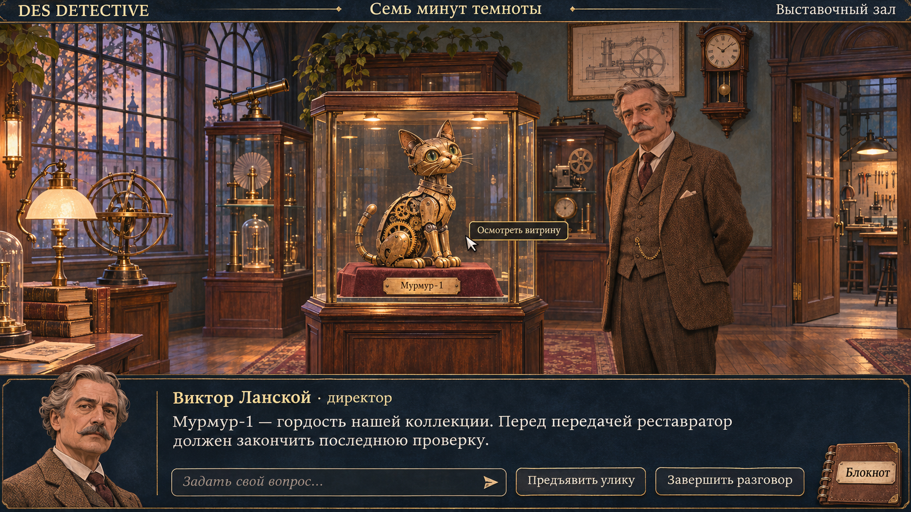

# DES Detective

**«У каждого своя правда. Но произошло только одно».**

Браузерный детективный 2D-квест. Первое дело — **«Семь минут темноты»**: в небольшом музее техники пропадает механический кот Мурмур-1. Осматривай комнаты, разговаривай с участниками, сопоставляй сведения и обоснуй итоговое заключение.



**[Играть в DES Detective](https://detective.xn--80apabgcz6atx4h.xn--p1ai/)** · [Раздел игр Котификации](https://xn--80apabgcz6atx4h.xn--p1ai/games#passport-des-detective)

Игра опубликована на Котификации и размещена на сервере в Праге. В DES Control Center работает управление эфиром Luna: «Начать эфир» / «Окончить эфир». Платные обращения разрешает оператор; при закрытом эфире доступны авторские реплики.

Это публичная копия рабочего прототипа. Иллюстрации созданы с помощью генерации изображений. Изображение выше — концепт; рабочий интерфейс развивается отдельно.

## Что работает

- Четыре локации: зал, мастерская, пост охраны и служебный коридор.
- Четыре персонажа с разными знаниями и секретами.
- Осмотр, документы, архивные фрагменты камер и поиск экспоната.
- Блокнот с отдельными наблюдениями, показаниями и личными версиями.
- Сопоставление сведений и заключение по шести вопросам с выбором доказательств.
- Автосохранение, перенос сохранения и новая игра с подтверждением.
- Авторские разговоры со всеми персонажами; свободный диалог со всеми четырьмя персонажами через **OpenAI GPT-6 Luna**.

## Локальный запуск без ИИ

Скачай репозиторий и открой `index.html` в браузере. Зависимости и API key не нужны. Вопросы можно выбирать кнопками или писать своими словами: локальный распознаватель ищет подходящую авторскую тему.

Tab / Enter выбирают действия с клавиатуры, Escape закрывает окно. «Показать объекты» подсвечивает зоны взаимодействия. Происшествие запускается кнопкой «К началу показа»; ждать семь реальных минут не требуется.

## Локальный запуск с GPT-6 Luna

Нужны Node.js 22+ и собственный OpenAI API key с доступом к `gpt-6-luna`. API-запросы оплачиваются в аккаунте владельца ключа.

**Windows PowerShell**, из папки проекта:

```powershell
powershell -NoProfile -ExecutionPolicy Bypass -File .\start-game.ps1
```

Введи ключ в скрытом запросе. Он передаётся Node-процессу через `DES_DETECTIVE_OPENAI_API_KEY`, не записывается в файл и не отправляется браузеру. Enter без ключа запускает локальный режим.

Открой [http://127.0.0.1:4317](http://127.0.0.1:4317). В разговоре с любым персонажем включи галочку GPT-6 Luna. Пока галочка выключена, внешних запросов нет. Остановить сервер — Ctrl + C. После изменения серверного кода перезапусти его и обнови страницу.

На других системах задай `DES_DETECTIVE_OPENAI_API_KEY` безопасным способом в окружении процесса и выполни:

```text
node server.cjs
```

Не размещай ключ в коде, браузерной консоли, сохранении или issue. Сервер предназначен для локального запуска: он слушает только `127.0.0.1`, а не публичный интерфейс.

## Как устроен разговор

Движок хранит состояние мира и разрешённые открытия. Для модели формируется контекст конкретного персонажа и этапа расследования. Истории разговоров персонажей разделены. В блокнот могут попадать канонические показания по разрешённым идентификаторам; свободная реплика сама по себе не создаёт физическую улику.

Для OpenAI используется Responses API, Structured Outputs и `store:false`. Передаются вопрос, разрешённые сведения и до 12 последних реплик текущего персонажа. История свободного разговора живёт в текущей вкладке, а канонические показания сохраняются вместе с игрой. Генерация может ошибаться: сюжетная последовательность живой модели остаётся предметом тестирования.

## Сохранения

Прогресс хранится в localStorage браузера. Файл `file://` и адрес локального сервера имеют разные хранилища. Для перехода используй «Перенос сохранения»: скопируй текст по старому адресу и импортируй по новому. Импорт заменяет прогресс нового адреса. Доступность localStorage при открытии файла зависит от браузера; очистка браузерных данных удаляет сохранения.

## Проверки

Без установки зависимостей, из корня проекта:

```text
node tests/quality.cjs
node --test tests/server.cjs tests/client-luna.cjs
```

Проверки проходят игровой сценарий, обработчики интерфейса, сохранения, условия признаний, разделение знаний и HTTP-границы сервера. Ответы API подставные: тесты не используют ключ и не расходуют средства. Они не заменяют визуальное прохождение в настоящем браузере и проверку живой модели.

## Ограничения и спойлеры

Это прототип: персонажи включены в изображения комнат; архив камер и технические осмотры представлены текстом. Оценка заключения использует заранее определённые достаточные наборы источников.

Исходники содержат разгадку дела. Сначала сыграй, если хочешь расследовать без спойлеров.

## Лицензия

Лицензия пока не выбрана.


## Контрольная версия 0.1.0

Первое дело полностью пройдено владельцем проекта со свободными разговорами со всеми четырьмя персонажами, включая стресс-проверку характеров. Замечаний по этому прохождению не было. Автоматические тесты проверяют игровую логику и подставные ответы API; поведение модели не становится полностью детерминированным.

У каждого персонажа отдельный набор разрешённых знаний и собственная история до 12 реплик. Бытовая актёрская импровизация допустима; игровые факты, улики и канонические показания ограничиваются движком. Прежние авторские темы, сохранения и заключение работают вместе с Luna.

## Публикация и управление эфиром

Игра уже [доступна по HTTPS](https://detective.xn--80apabgcz6atx4h.xn--p1ai/) и опубликована в [разделе игр Котификации](https://xn--80apabgcz6atx4h.xn--p1ai/games#passport-des-detective). Размещение — **Прага**.

В **DES Control Center** добавлено управление «Начать эфир» / «Окончить эфир». Оно разрешает или блокирует платные вызовы Luna на стороне сервера. Галочка в браузере выбирает режим разговора, но не включает закрытый оператором эфир. Без Luna игра продолжает работать с авторскими репликами.

Это действующая интеграция, а не план будущего этапа. Размещение и наличие управления подтверждены владельцем проекта 22 ноября 2026 года; страница игры и публичный API статуса также проверены на доступность по HTTPS. Переключение эфира при обновлении документации не выполнялось.

Тег `v0.1.0` сохраняет историческую контрольную версию исходников. Инструкции локального запуска выше относятся к этой публичной копии; конфигурация размещённой службы и её административные секреты в репозиторий не входят. См. [состояние публикации](docs/publication-plan.md).
